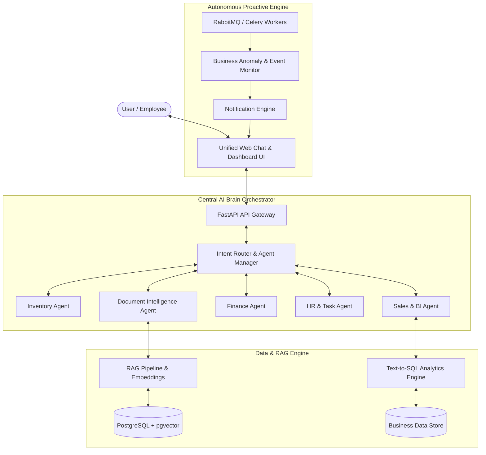

# Nexora AI — Platform Architecture & Implementation Roadmap

Nexora AI is an autonomous, multi-tenant Business Intelligence & Autonomous AI Assistant Platform designed for enterprise and SMB operational excellence.

---

## 1. System Vision & Architecture Mapping

---

## 2. Core Functional Modules & Technical Implementation Plan

### Module 1: Document Intelligence Engine
- **Supported Formats**: PDF, DOCX, XLSX/XLS, PPTX, Images (OCR).
- **Capabilities**:
  - File parser service (`pypdf`, `python-docx`, `pandas`, `openpyxl`).
  - Text chunking & vector embedding generation (`text-embedding-3-small` / Gemini Embeddings).
  - Hybrid Search (`pgvector` cosine similarity + full-text search).
  - Document comparison & verification engine.

### Module 2: Business Analytics & Text-to-SQL Engine
- **Capabilities**:
  - Secure Text-to-SQL engine for business metrics (Sales, Inventory, Finance).
  - Trend detection & anomaly explanation ("Why sales dropped this month").
  - Automated chart and report generation (JSON chart spec for UI rendering).

### Module 3: Proactive Autonomous Monitoring Worker
- **Capabilities**:
  - Background cron jobs (`RabbitMQ` + `Celery`/`Asyncio Tasks`).
  - Stock level thresholds & inventory depletion speed forecasting.
  - Financial anomaly alerts & deadline tracking.
  - Push notifications via WebSockets & Notification API.

### Module 4: Adaptive Multi-Agent Orchestrator
- **Capabilities**:
  - Central Agent Router selecting specialized prompt personas and toolsets:
    1. **Inventory Assistant**
    2. **Sales Analytics Assistant**
    3. **Finance Assistant**
    4. **HR & Tasks Assistant**
    5. **Document Management Assistant**
    6. **Project Management Assistant**

---

## 3. Immediate Technical Implementation Milestones

- [x] **Phase 1: Foundation Clean Architecture** (FastAPI, Modular routers, Multi-tenant DB schema, OpenRouter/Gemini AI providers, Glassmorphism UI)
- [ ] **Phase 2: Full Document Intelligence & RAG** (File parsers for PDF/Excel/Docx, Vector search endpoints, Document Q&A)
- [ ] **Phase 3: Central Multi-Agent Orchestration** (Tool calling, Agent router, Dynamic module switching)
- [ ] **Phase 4: Proactive Monitoring Engine** (Background workers, Anomaly detection, Real-time Alerts & SSE Streaming)
- [ ] **Phase 5: Advanced BI Dashboard & Custom Connectors** (Interactive analytics charts, Enterprise integrations)
